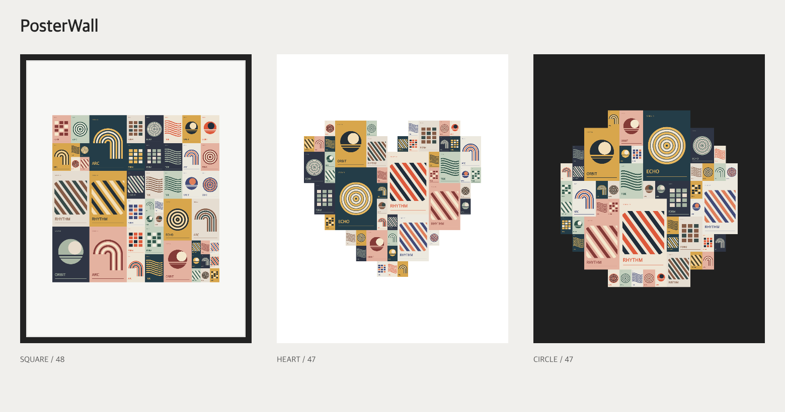

# PosterWall

把电影、动漫、游戏、音乐和书籍封面拼成一张可以分享的海报墙。

选择方形、横幅、竖幅、心形、圆形或拱形，用不同大小的封面拼出轮廓，再搭配托纸、相框或自定义背景。支持图片重复使用，以及 PNG、JPG 和透明背景导出。

## 效果预览



## 运行网站应用

需要 Node.js 22 或以上。

```bash
git clone git@github.com:bluedinosaur233/PosterWall.git
cd PosterWall
npm ci
npm run dev
```

打开 <http://127.0.0.1:4180>，导入并勾选图片，选择形状、层级、海报数量和底座，调整后导出。图片与草稿在浏览器本机处理，也可以保存项目文件，之后继续编辑。

点击「随机布局」尝试不同排列；放大预览后，从素材栏拖入可替换封面，拖动两张海报可交换位置。也支持点选操作。点击「适应」回到完整视图。

部署到自己的网站：

```bash
npm run build
```

将 `dist/` 放到静态网站目录。详细步骤见 [部署说明](docs/deploy.md)。

## 让 Agent 使用

把仓库和图片目录交给 Agent，让它参考现有模板生成，或按你的想法自定义排版。例如：

> 阅读这个仓库的 AGENTS.md，参考心形模板，用我提供的图片生成一张海报墙。采用 3 种尺寸、白色托纸，导出 2 倍 PNG 和可继续编辑的项目文件。

参数见 [项目格式](docs/project-format.md)，封面来源见 [图源指引](docs/cover-sources.md)。
